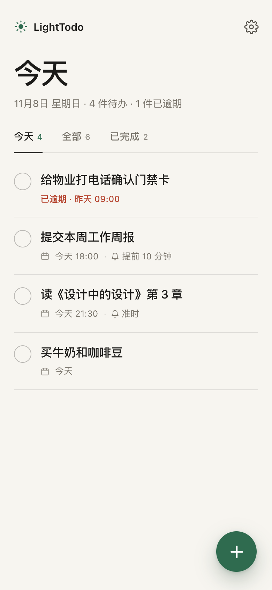

# cbam-agent

## LightTodo · 轻待办 V0.1（前端 MVP）

按《LightTodo PRD V0.1》实现的可运行前端页面：**3 秒记下一件事，打开即见今天要做什么。**

移动优先的 Web 实现，React + TypeScript + Vite，无后端、无需登录，任务只保存在浏览器本地。



### 运行

```bash
npm install
npm run dev        # 本地开发
npm run build      # 生产构建
npm run preview    # 预览生产构建
```

### 已实现

- **三个视图**：今天 / 全部 / 已完成，按 PRD 规则过滤与排序；逾期任务红字标识。
- **任务闭环**：创建、查看详情、即时保存编辑、勾选完成、左滑删除；空标题 / 超 100 字禁用提交并红字提示。
- **撤销 Toast**：添加、完成、删除后 5 秒内可撤销，超时删除不可恢复。
- **截止日期与提醒**：今天 / 明天 / 自定义日期，可选时间；准时、提前 10 分钟、提前 1 小时、提前 1 天。已过期时间允许创建并标记逾期。
- **通知与兜底**：浏览器通知权限引导；权限被拒时首页顶部常驻可关闭引导条；页面打开时始终有应用内提醒；重新打开时补发最近 24 小时错过的提醒。
- **设置**：提醒总开关、通知权限引导、关于与隐私政策（仅 3 项）。
- **数据免责声明**：首次启动页与设置页明示「数据仅存本机」。
- **体验细节**：空状态插画、移动端底部面板、桌面居中布局、系统字体缩放、`prefers-reduced-motion`、键盘可操作。
- **离线可用**：Service Worker 缓存应用外壳，首次加载后可离线打开。
- **埋点**：PRD 的 4 个事件（`app_open`、`task_create`、`task_complete`、`reminder_open`）记录到本地，供后续接入上报。

### 验证

```bash
npm test                     # 20 个单元测试（排序、日期、校验、提醒、数据操作）
npm run build                # TypeScript + Vite 生产构建
npx playwright test          # 34 个端到端用例（移动端 + 桌面端）
CAPTURE_SCREENSHOTS=1 npx playwright test e2e/screenshots.spec.ts --project=mobile
```

端到端用例覆盖：首次启动、创建与校验、完成/删除撤销、左滑删除、即时保存、三视图排序、设置持久化、通知权限被拒引导、到点提醒（含跨周与错过后补发）、首次访问后的离线打开。

### Web 原型的限制

PRD 的目标形态是原生 App；当前交付是 Web 前端实现，因此：

- **提醒依赖页面保持打开**。浏览器关闭、设备休眠或系统限制后台标签页时，无法像原生本地通知那样可靠触发。
- 通知能力取决于浏览器与用户授权；不支持通知的浏览器只在应用内提醒。
- 数据存于 `localStorage`，清理站点数据、换浏览器或换设备都会丢失（与「不做账号与同步」的 MVP 边界一致）。
- 首次访问需要网络加载应用；之后由 Service Worker 提供离线外壳。

### 目录

```
src/            页面、组件、任务/日期/存储逻辑
tests/          Vitest 单元测试
e2e/            Playwright 端到端测试与截图脚本
docs/screenshots/  验证截图（before/after）
```

---

- [CBAM 监测计划（Monitoring Plan）](monitoring-plan/README.md)
